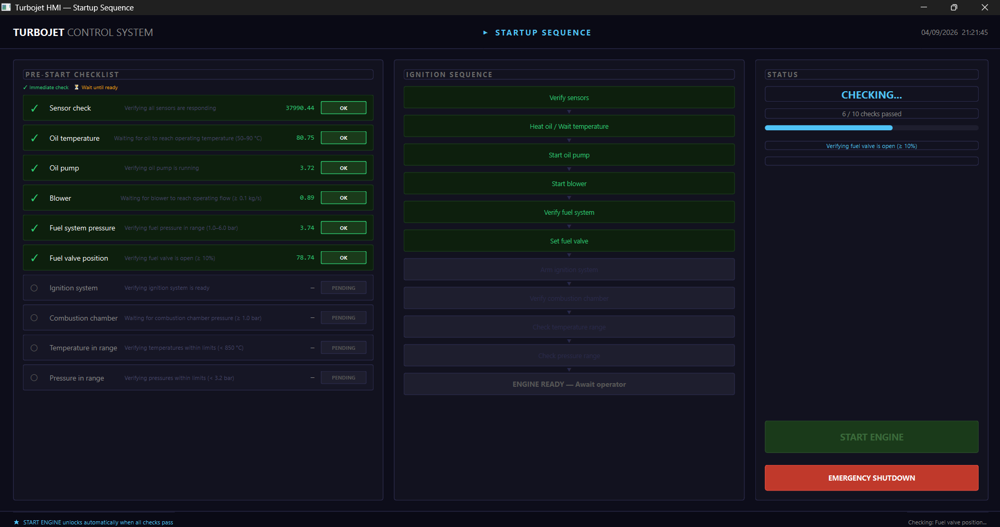
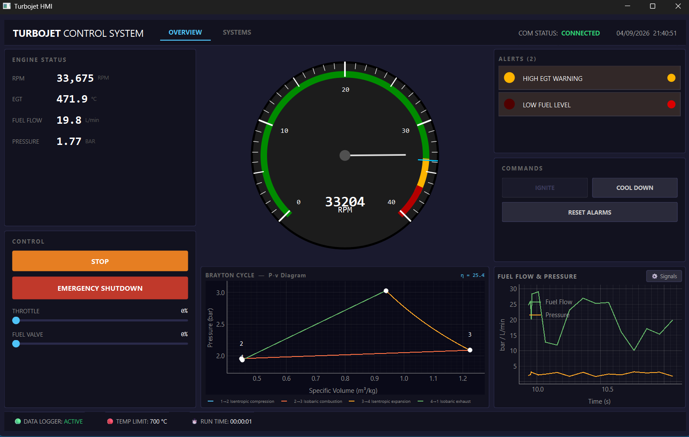
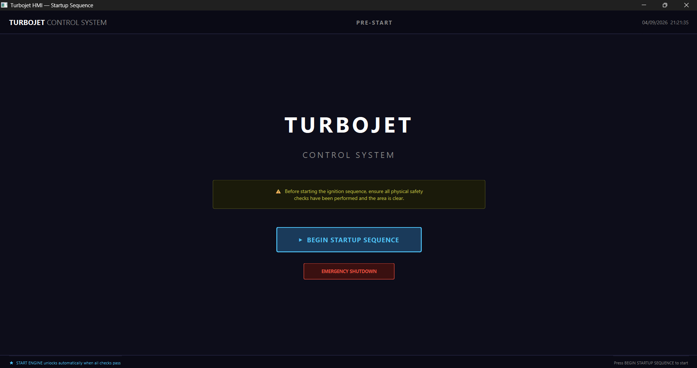

# Informe de avance de la interfaz HMI del turborreactor

**Fecha:** 4 de septiembre de 2026

> **Nota de vigencia:** el cuerpo histórico de este informe describe la versión con datos simulados. La implementación actual de recepción serial y su alcance de solo lectura se documentan en la sección [Estado actual de la implementación](#estado-actual-de-la-implementación) y en [SERIAL_PROTOCOL.md](SERIAL_PROTOCOL.md).

La interfaz desarrollada actualmente corresponde a un sistema HMI para la supervisión y operación de un turborreactor. El programa inicia con una pantalla de preparación y encendido, en la que se ejecuta una secuencia de verificaciones previas antes de habilitar el arranque del motor. Posteriormente, el usuario accede a la pantalla principal de operación.

La aplicación está organizada de forma modular: el punto de entrada coordina la ventana de inicio, la ventana principal, la generación de datos y el registro de las sesiones; el estado del motor centraliza las variables y los límites de alarma; y los paneles y widgets separan la presentación de datos, los controles, las alarmas y las gráficas. Esta organización facilita modificar un componente sin afectar toda la interfaz y deja preparada la sustitución de los datos simulados por una fuente de comunicación real.

En la pantalla de inicio se presenta una lista de diez comprobaciones relacionadas con sensores, temperatura y presión del aceite, bomba de aceite, blower, sistema de combustible, posición de la válvula, sistema de ignición, cámara de combustión, temperatura y presión. Cada comprobación muestra su estado, el valor recibido del sensor y una indicación visual de progreso. La pantalla también incluye una secuencia de encendido, un resumen del estado general, el número de verificaciones aprobadas, una barra de progreso, el botón de inicio del motor y el botón de apagado de emergencia. El arranque permanece bloqueado hasta que las condiciones configuradas se cumplen.

Las verificaciones se dividen en comprobaciones inmediatas y comprobaciones que esperan a que una variable alcance un rango o valor mínimo. Por ejemplo, se valida que los sensores respondan, que la temperatura del aceite esté entre 50 y 90 °C, que exista presión de aceite, que el flujo de aire sea suficiente, que la presión del combustible esté entre 1 y 6 bar y que la válvula tenga una apertura mínima del 10 %. En los casos que requieren espera se contempla un tiempo máximo, de forma que el operador pueda identificar un bloqueo o una condición anormal.

*Figura 1. Pantalla de inicio con la lista de verificaciones previas, la secuencia de ignición y el estado de habilitación del motor.*

En la pantalla principal se concentra la operación y la supervisión del motor en tiempo real. La vista muestra las revoluciones por minuto, la temperatura de gases de escape, el flujo de combustible y la presión. También incorpora un indicador gráfico de RPM, una representación del ciclo Brayton mediante un diagrama P-v, una gráfica configurable de flujo de combustible y presión, un panel de alarmas y un panel de comandos. Desde esta pantalla se pueden ejecutar las acciones de parada, apagado de emergencia y reinicio de alarmas. La interfaz informa además el estado de comunicación, la hora, el tiempo de operación y el estado del registro de datos.

La distribución prioriza la lectura rápida: las variables esenciales se ubican en el panel izquierdo, el indicador circular permite observar de inmediato el régimen de giro y la zona derecha concentra las alarmas y las acciones de operación. La codificación por color diferencia estados normales, advertencias y condiciones críticas. Las gráficas complementan los valores instantáneos con una lectura de tendencia y con la representación del ciclo termodinámico del motor.

La aplicación cuenta con una segunda vista de sistemas para consultar variables agrupadas en los sistemas principal, de combustible y de lubricación. Cada variable se presenta con su valor, unidad, barra de nivel y estado, clasificado como normal, advertencia o falla según los límites definidos para el motor.

En esta vista se supervisan variables como temperatura, presión y flujo de admisión; temperatura y presión de combustión; velocidad del turbo; presión de sobrealimentación; nivel y presión del tanque; posición de la válvula; presión y temperatura del combustible; y variables de lubricación como presión, temperatura, flujo, nivel, velocidad de la bomba y caída de presión del filtro. Cada grupo tiene límites de advertencia y falla, por lo que la lectura no depende únicamente del valor numérico sino también de su interpretación operacional.

*Figura 2. Pantalla principal con telemetría, indicador de RPM, alarmas, comandos y gráficas de operación.*

Como antecedente de la evolución de la interfaz, se conserva la pantalla inicial de bienvenida, desde la cual el operador inicia la secuencia de preparación del sistema.

*Figura 3. Pantalla inicial de bienvenida y confirmación de las condiciones de seguridad.*

Como parte del funcionamiento actual, los datos de prueba son generados periódicamente para simular la telemetría del turborreactor. Esta fuente entrega variables de RPM, temperaturas, presiones, flujos, niveles, posición de válvulas y variables asociadas a los sistemas de combustible y lubricación. La arquitectura permite reemplazar posteriormente esta fuente de prueba por una comunicación con sensores o con el sistema de control real.

La actualización de la interfaz se realiza mediante señales y eventos de Qt, lo que permite que la llegada de nuevos datos actualice simultáneamente los indicadores, los paneles, las alarmas y las gráficas sin bloquear la ventana principal. En el estado actual, la fuente es un generador de prueba con valores variables y aleatorios; por tanto, los resultados visualizados sirven para validar la interacción y la presentación, pero no representan todavía mediciones físicas del turborreactor.

El sistema de alarmas evalúa los valores recibidos frente a límites centralizados. Entre las condiciones contempladas se encuentran temperatura elevada, bajo nivel o flujo de combustible, exceso de RPM y presión fuera de rango. Las alarmas se registran en el panel de la interfaz y pueden restablecerse desde el panel de comandos.

También se implementó un registrador de datos que crea un archivo CSV por sesión. En estos archivos se almacenan la fecha y hora, el tiempo transcurrido, las RPM, la temperatura EGT, el flujo de combustible y la presión. Actualmente se encuentran disponibles registros de sesiones en la carpeta `logs`, lo que permite conservar evidencia de las pruebas realizadas y revisar posteriormente el comportamiento de las variables principales.

El registro se inicia al abrir la aplicación, crea un archivo identificado con la fecha y hora de la sesión y escribe los datos recibidos con un intervalo aproximado de 0,1 segundos. Este mecanismo permite reconstruir la evolución de las variables principales durante una prueba y proporciona una base para incorporar posteriormente análisis, exportación o comparación entre sesiones.

## Línea de tiempo condensada

La evolución del proyecto puede resumirse en tres momentos: primero se estableció la estructura modular de la aplicación; después se incorporaron la generación de datos de prueba, el modelo de estado del motor, el sistema de alarmas y el registro CSV; finalmente se integraron las pantallas de inicio, supervisión, control, gráficas y consulta de sistemas. El estado actual es una interfaz funcional de demostración y validación, preparada para continuar con la integración de datos reales y pruebas de operación más amplias.

## Referencias de apoyo

Las siguientes fuentes se utilizaron como referencia conceptual y técnica para documentar la interfaz y sus componentes:

1. NASA Glenn Research Center. *Brayton Cycle*. Referencia sobre el ciclo termodinámico representado en el diagrama P-v: https://www.grc.nasa.gov/www/k-12/airplane/brayton.html
2. The Qt Company. *Qt for Python Documentation*. Referencia para la construcción de interfaces, widgets, señales y eventos utilizados en la aplicación: https://doc.qt.io/qtforpython-6/
3. Python Software Foundation. *csv — CSV File Reading and Writing*. Referencia para la generación y escritura de los archivos de registro de las sesiones: https://docs.python.org/3/library/csv.html

Estas referencias respaldan los conceptos generales y las herramientas empleadas; los valores, límites, datos de prueba y distribución específica descritos en este informe corresponden al prototipo desarrollado para el proyecto.

## Estado actual de la implementación

La descripción anterior documenta la versión de demostración con datos simulados y controles de interfaz. La implementación actual reemplaza esa fuente por recepción serial de telemetría de solo lectura y presenta pestañas OVERVIEW, TEMPERATURES, FUEL & SAFETY, TRENDS y ALARMS, con un mimic del proceso, perfil térmico y banner de alarmas. El formato acordado para la ESP32-S3 está en [SERIAL_PROTOCOL.md](SERIAL_PROTOCOL.md). La interfaz muestra únicamente alarmas reportadas por la ESP32; no define umbrales, no envía comandos y no sustituye las protecciones independientes del controlador. Los perfiles de configuración quedan fuera de esta etapa.

El registrador CSV actual guarda tiempo, secuencia y T1–T5, MAF, RPM y MQ6-1/MQ6-2 por sesión conectada. Sin conexión serial, la interfaz indica que no hay telemetría y no genera datos ficticios.
